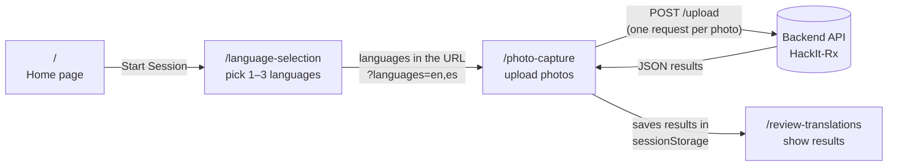

# HackIt-Rx — Frontend (Medicine Label Explainer website)

This is the **frontend**, the website people actually see and click on, of a hackathon project that helps pharmacists, patients and caregivers understand medicine labels in their own language.

**Live site:** https://hack-it-rx-front-end.vercel.app

Using the site takes three steps:

1. **Pick up to 3 languages** (for example English, Spanish and Hindi).
2. **Upload photos** of medicine labels or prescriptions.
3. **See the translations.** The site shows the text read from each photo, translated into every chosen language.

The website doesn't do the reading or translating itself. It sends the photos to a separate **backend** server, **[HackIt-Rx](https://github.com/bharathan03/HackIt-Rx)**, which uses OpenAI to do the AI work and sends the results back.

---

## Table of contents

- [How the frontend and backend fit together](#how-the-frontend-and-backend-fit-together)
- [Tech used (and what each thing is)](#tech-used-and-what-each-thing-is)
- [The user journey, page by page](#the-user-journey-page-by-page)
- [Folder structure: what every file does](#folder-structure-what-every-file-does)
- [Running it on your own computer](#running-it-on-your-own-computer)
- [How it's deployed (Vercel)](#how-its-deployed-vercel)
- [Known quirks and leftover code](#known-quirks-and-leftover-code)

---

## How the frontend and backend fit together



Here's the key idea. Pages pass information to each other in two ways:

- **Through the URL.** The chosen language codes are added to the address, like `/photo-capture?languages=en,es,hi`, so the next page knows which languages were picked.
- **Through `sessionStorage`.** After the backend replies, the results are saved in the browser's `sessionStorage`, a small built-in storage area that lasts until the browser tab is closed. The review page then reads the results from there.

There's **no database and no login**. Everything is temporary and lives in the user's browser tab.

---

## Tech used (and what each thing is)

| Tool | What it is | Why it's here |
|---|---|---|
| **[Next.js 14](https://nextjs.org/)** | A framework for building websites with React. | Handles pages, routing (URLs) and building the site for production. |
| **[React 18](https://react.dev/)** | A JavaScript library for building user interfaces from reusable "components". | Every page and icon is a React component. |
| **[TypeScript](https://www.typescriptlang.org/)** | JavaScript with **types**, so you can say "this variable is a string", which helps catch mistakes early. | All the code is written in `.ts` / `.tsx` files. |
| **[Tailwind CSS](https://tailwindcss.com/)** | A styling tool where you style things by adding short class names like `bg-blue-600 rounded-xl`. | All the visual styling. There are almost no separate CSS files. |
| **PostCSS + Autoprefixer** | Tools that process CSS behind the scenes. | Tailwind needs them. You never touch them directly. |
| **Axios** | A library for making HTTP requests. | Set up in `src/lib/api.ts` but **not actually used**. The app uses the browser's built-in `fetch` instead. |
| **ESLint** | A tool that checks code for common mistakes. | Run with `npm run lint`. |
| **[Vercel](https://vercel.com/)** | A hosting service, made by the same company as Next.js. | Hosts the live site. |

> **`.tsx` vs `.ts`:** a `.tsx` file contains TypeScript **plus** JSX, the HTML-looking syntax React uses (`<div>…</div>`). A `.ts` file is plain TypeScript with no HTML.

> **`'use client'`:** you'll see this at the top of most files. In Next.js 14, components run on the server by default. `'use client'` says "run this in the browser", which is needed for anything interactive such as buttons, `useState`, uploads or `sessionStorage`.

---

## The user journey, page by page

In Next.js's **App Router**, the folder structure *is* the URL structure. A file at `src/app/photo-capture/page.tsx` automatically becomes the page at `/photo-capture`.

### 1. Home: `/` → `src/app/page.tsx`

This is a landing page with the title "Medicine Label Explainer", a short description, a **Start Session** card and three feature highlights: 11+ languages, real-time sync and no account required.

Clicking **Start Session** runs `router.push('/language-selection')`, which moves to the next page.

### 2. Language selection: `/language-selection` → `src/app/language-selection/page.tsx`

- Shows all 11 languages from `src/constants/languages.ts` as clickable cards.
- English is selected by default.
- You must keep **at least 1** language selected and can pick **at most 3**. The `handleLanguageToggle` function enforces these rules.
- The **first** selected language is marked as the "Primary Language".
- **Continue** sends you to `/photo-capture?languages=en,es,hi`, with the chosen codes in the URL.

### 3. Photo upload: `/photo-capture` → `src/app/photo-capture/page.tsx`

This is the most important page, because it's where the frontend talks to the backend.

1. **Reads the languages from the URL** (`useSearchParams`) and looks up their full details in `LANGUAGES`.
2. **Lets you add photos**, either with the upload button (which opens the file picker and allows several files) or by dragging and dropping.
3. **Shows previews.** Each image is read with `FileReader` into a "data URL" so it can be displayed right away, and each has a remove button.
4. **Processes photos** when you click **Process N Photos**. This runs `handleProcessPhotos`:
   ```ts
   // For EACH photo, at the same time (Promise.all):
   const formData = new FormData()
   formData.append('image', photo.file)                       // the image file
   formData.append('languages', JSON.stringify(languageNames)) // e.g. ["English","Spanish"]
   await fetch(`${API_BASE_URL}/upload`, { method: 'POST', body: formData })
   ```
   - `API_BASE_URL` comes from the `NEXT_PUBLIC_API_URL` environment variable. If that isn't set, it falls back to `http://localhost:8080`.
   - It sends language **names** ("Spanish"), not codes ("es"), because the backend puts the name directly into the AI prompt.
5. **Saves all the results** to `sessionStorage` under the key `medicineResults`, then goes to `/review-translations?languages=...`.
6. If any upload fails, it shows an alert: "Failed to process photos. Please try again."

### 4. Review: `/review-translations` → `src/app/review-translations/page.tsx` + `data.tsx`

- `data.tsx` defines a **custom React hook** called `useMedicineData`. A hook is a reusable function that manages data and state. This one:
  1. Reads `medicineResults` from `sessionStorage`.
  2. Reshapes the backend's reply `{ original_text, translations: { "Spanish": "..." } }` into the format the page expects: `medicine_name` holds the original text, and `translations` becomes a list of `{ language, medicine_name_translation }`.
  3. Returns `{ medicines, loading, error }`.
- `page.tsx` shows one card per photo. Each card contains the original extracted text (under the primary language) and a **TRANSLATIONS** section with one box per language, followed by a summary at the bottom: "Total medicines processed" and "Languages supported".
- If there's nothing in `sessionStorage`, for example because the page was opened directly, it shows "No medicine data found. Please go back and upload photos."

---

## Folder structure: what every file does

```
HackIt-Rx_FrontEnd/
├── README.md               ← you are here
├── package.json            ← project info + list of libraries + npm commands
├── package-lock.json       ← exact versions of every installed library (auto-generated)
├── next.config.js          ← Next.js settings
├── tailwind.config.ts      ← Tailwind settings (which files to scan for class names)
├── postcss.config.js       ← plugs Tailwind into the CSS build (rarely touched)
├── tsconfig.json           ← TypeScript settings (incl. the "@/..." import shortcut)
├── .gitignore              ← files Git should NOT upload (node_modules, .env, builds)
└── src/
    ├── app/                            ← PAGES (folder name = URL)
    │   ├── layout.tsx                  ← wrapper around every page: <html>, font, tab title
    │   ├── globals.css                 ← global styles; loads Tailwind
    │   ├── page.tsx                    ← "/"  home page
    │   ├── language-selection/
    │   │   └── page.tsx                ← "/language-selection"
    │   ├── photo-capture/
    │   │   └── page.tsx                ← "/photo-capture"  (calls the backend!)
    │   └── review-translations/
    │       ├── page.tsx                ← "/review-translations"
    │       └── data.tsx                ← useMedicineData hook: loads results from sessionStorage
    ├── components/                     ← reusable UI pieces
    │   ├── BackIcon.tsx, CameraIcon.tsx, CheckIcon.tsx, GlobeIcon.tsx,
    │   │   MultiLanguageIcon.tsx, PillIcon.tsx, ShieldIcon.tsx,
    │   │   SyncIcon.tsx, UsersIcon.tsx ← small SVG icon components
    │   └── LanguageSelection.tsx       ← an older, reusable version of the language picker (unused)
    ├── constants/
    │   └── languages.ts                ← the list of 11 supported languages
    ├── lib/
    │   └── api.ts                      ← API helper functions (mostly unused, see below)
    └── types/
        └── index.ts                    ← generic TypeScript types (unused template leftovers)
```

### Root config files

- **`package.json`** is the project's ID card. It lists the libraries the project needs (`dependencies`) and the shortcut commands (`scripts`):
  - `npm run dev` starts a development server with live reload.
  - `npm run build` builds an optimized production version. This is what Vercel runs.
  - `npm start` runs that production build.
  - `npm run lint` checks the code for problems.
- **`package-lock.json`** records the exact version of every library so everyone installs the same thing. It's generated automatically, so don't edit it by hand.
- **`next.config.js`** holds the Next.js settings:
  - `experimental.appDir: true` was needed in Next 13 to enable the `src/app` folder. In Next 14 it's on by default, so this line is harmless but no longer needed.
  - `rewrites()` would forward `/api/...` requests to `http://localhost:8080/api/...`. The app doesn't use this, because it calls the backend URL directly and the backend has no `/api` routes.
- **`tsconfig.json`** holds the TypeScript settings. The important part for beginners is `"paths": { "@/*": ["./src/*"] }`. It means `import { LANGUAGES } from '@/constants/languages'` is a shortcut for `src/constants/languages`, so you don't need long `../../` paths.
- **`tailwind.config.ts`** tells Tailwind which files to scan for class names. Tailwind only includes the CSS for classes it actually finds.
- **`postcss.config.js`** connects Tailwind and Autoprefixer to the CSS build. You'll rarely need to touch it.

### `src/app/`: pages

- **`layout.tsx`** is the "frame" that wraps every page. It sets the `<html>` tag, loads the **Inter** font from Google Fonts, imports `globals.css` and sets the browser tab title ("MedExplain - Medicine Instructions Made Simple").
- **`globals.css`** loads Tailwind (`@tailwind base/components/utilities`) and sets the default font.
- **Each `page.tsx`** is one screen. See [The user journey](#the-user-journey-page-by-page) above.
- **`review-translations/data.tsx`** holds the `useMedicineData` hook that loads and reshapes the results.

> Note: `photo-capture/page.tsx` and `review-translations/page.tsx` define their own small icons (like `BackIcon` and `UploadIcon`) at the top of the file instead of importing them from `components/`. That's why those files are long. Most of the length is SVG drawing code and Tailwind classes, not logic.

### `src/components/`: reusable pieces

- **The `*Icon.tsx` files** are each a tiny component that draws one SVG icon, so a page can just write `<CameraIcon />`.
  - `UsersIcon` isn't used anywhere.
  - `PillIcon` is imported on the home page but not displayed.
- **`LanguageSelection.tsx`** is an earlier, reusable version of the language picker that takes `onBack` / `onContinue` callbacks. It isn't used. The real page is `app/language-selection/page.tsx`, which has nearly identical code.

### `src/constants/languages.ts`

This file holds the single list of supported languages. Each has a `code` (`"es"`), a `name` (`"Spanish"`), a `nativeName` (`"Español"`) and a `flag` emoji. **To add a language, add a line here.** It will then appear on the selection page automatically. The backend handles any language name OpenAI understands.

### `src/lib/api.ts`

This file was intended as the central place for all backend calls. It contains:

- `API_BASE_URL`: `process.env.NEXT_PUBLIC_API_URL`, or `http://localhost:8080` if that isn't set.
- An Axios instance `api` with "interceptors" that add a login token and redirect to `/login` on errors. **This is unused**, and there is no login page.
- TypeScript interfaces describing an older, more detailed response shape (`medicine_name`, `dosage`, `instructions`, …).
- `extractMedicineInfo`, `extractSessionMedicines` and `fetchMedicineImage`. **None of these are called anymore.** The photo page calls `fetch(.../upload)` directly with `FormData`.

`review-translations/data.tsx` still imports the `Translation` **type** from here, so don't delete the file without moving that type.

### `src/types/index.ts`

This file holds generic `User`, `ApiResponse` and `PaginatedResponse` types from a starter template. None of them are used.

---

## Running it on your own computer

### 1. Install Node.js

Install **[Node.js](https://nodejs.org/) 18 or newer**, because Next.js 14 requires it. This also installs `npm`, the tool that downloads JavaScript libraries. Check your versions with:

```bash
node --version
npm --version
```

### 2. Install the project's libraries

```bash
cd HackIt-Rx_FrontEnd
npm install
```

This reads `package.json` and downloads everything into a `node_modules/` folder, which can be large. That folder is ignored by Git.

### 3. Start the backend

Follow the **"Running it on your own computer"** section of the [backend README](https://github.com/bharathan03/HackIt-Rx). Start it on **port 8080**:

```bash
uvicorn main:app --reload --port 8080
```

### 4. (Optional) Point the frontend at a different backend

By default the frontend calls `http://localhost:8080`. To use a different backend, for example the deployed one, create a file called **`.env.local`** in the project root:

```
NEXT_PUBLIC_API_URL=https://your-backend-url.vercel.app
```

> Environment variables starting with `NEXT_PUBLIC_` are built into the browser code. That's fine for a URL, but **never put secrets** (like an API key) in them. That's exactly why the OpenAI key lives on the backend instead.

### 5. Start the frontend

```bash
npm run dev
```

Open **http://localhost:3000**. The backend already allows requests from `localhost:3000` through its CORS settings.

---

## How it's deployed (Vercel)

The frontend and backend are **two separate Vercel projects**, one per GitHub repo.

1. This repo is connected to a Vercel project. **Every push to `main` automatically redeploys** the live site at https://hack-it-rx-front-end.vercel.app. Pull requests and other branches get their own **preview URLs**.
2. Vercel detects that this is a Next.js app and runs `npm install` and then `npm run build` automatically. No extra config file is needed.
3. **Required environment variable:** in the Vercel project, go to Settings → Environment Variables and set **`NEXT_PUBLIC_API_URL`** to the backend's Vercel URL. If it's missing, the live site tries to call `http://localhost:8080`, which won't work for real users. After changing it, redeploy, because `NEXT_PUBLIC_` variables are baked in at build time.
4. The backend only accepts requests from `hack-it-rx-front-end.vercel.app`, its preview URLs and localhost. If you rename the frontend's domain, update the CORS settings in the backend's `main.py` too.

---

## Known quirks and leftover code

This was built fast at a hackathon, so some parts are unfinished or left over from earlier versions:

- **The instructions section is always empty.** `data.tsx` sets `instructions: []`, because the backend doesn't return separate instructions, so the INSTRUCTIONS heading shows with nothing under it.
- **`dosage` is always empty,** for the same reason. The backend returns one block of text, not separate name and dosage fields.
- **The primary language label is always "English"** in `data.tsx`, even if you chose a different first language.
- **The translation flags are hard-coded.** The review page only picks the right flag for Chinese and Indonesian; everything else gets 🌐.
- **"Real-time Sync" on the home page is a planned feature,** not something the app currently does.
- **Several files are unused:** `lib/api.ts` (except one type), `types/index.ts`, `components/LanguageSelection.tsx` and `components/UsersIcon.tsx`. So are the `rewrites` in `next.config.js`.
- **Icons are duplicated.** `photo-capture` and `review-translations` define their own icon components instead of reusing the ones in `components/`.
- **Refreshing the review page works,** because `sessionStorage` survives a refresh. **Opening it in a new tab doesn't,** because `sessionStorage` is per-tab.
